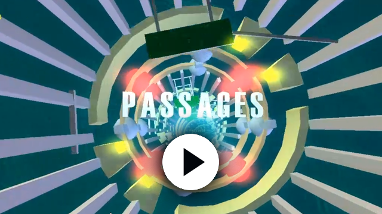

# Passages_Unfinished

Unfinished demo project "PASSAGES" - Genesis Project 2012  
C++ / OpenGL  
Code / Design / Modeling : Erk  
GFX : Razorback  
Musics : HJE - Sonic Wandered  

## Building

Requires Windows and Visual Studio 2026 with the *Desktop development with C++* workload (it includes CMake and vcpkg).

From a *Developer PowerShell for VS 2026*, at the root of the repository:

    cmake --preset vs2026
    cmake --build --preset release

The first configuration takes a few minutes: vcpkg builds GLFW, GLEW, Dear ImGui, libtiff, libjpeg-turbo and stb, and the BASS audio library is downloaded from [un4seen.com](https://www.un4seen.com).

Run `build\Release\Passages.exe`. The demo loads its textures, models and shaders from the repository root, wherever the executable is started from. It needs a graphics driver supporting OpenGL 4.6 (core profile); in Debug builds, OpenGL errors are printed to the console.

## Test bench

The demo can replay a scene with a fixed time step and save PNG captures, so that two builds can be compared image by image:

    Passages.exe --scene tunnel --temps-fixe 60 --captures 5,10,20 --sortie captures --references references

`outils\banc_essai.ps1 -References` records reference captures of every scene; `outils\banc_essai.ps1` then compares a new build against them.
